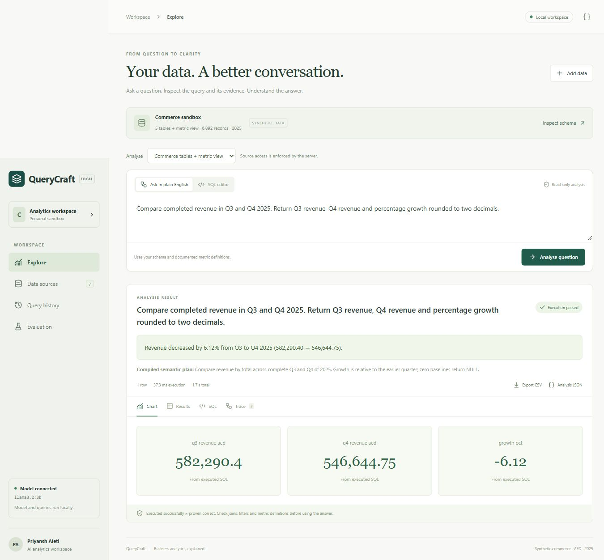

# QueryCraft

**Business analytics, explained.** A local AI analytics application with an inspectable question → plan/SQL → execution → chart workflow.

Built by Priyansh Reddy Aleti with substantial Codex assistance. This is an original portfolio implementation. No production customers, public hosting or independently audited accuracy are claimed.

[Download my AI Engineer CV](resume/Priyansh_Reddy_AI_Engineer_CV.pdf) · [Architecture](ARCHITECTURE.md) · [Demo guide](DEMO_GUIDE.md)



## Completed local release

- Five related synthetic commerce tables and a documented completed-sales semantic view.
- Natural-language-to-SQL, with visible SQL, results, trace and one bounded repair attempt.
- Typed quarter-comparison plans: model-extracted measure/grouping; server-compiled full-quarter aggregation, growth and optional refund-rate comparisons.
- Typed single-CSV aggregation, with source-aware column enums, quoted filter literals and server-owned rounding.
- Bar/line charts, metric cards, sortable tables, CSV and full-analysis JSON exports.
- CSV uploads, inferred-schema previews, null scans and server-enforced source selection.
- Persistent history, restored after reload/restart.
- Synthetic and public-data regression reports, independent Python calculations and retained failed experiments.
- Deployment package, optional authenticated demo gate and optional OpenAI Responses adapter. The user selected local inference for this release; cloud components are not deployed.

## Run locally

Requirements: Python 3.12+, Node 22+, pnpm 11+, and Ollama with llama3.2:3b for AI features.

```powershell
python -m venv .venv
.venv/Scripts/python.exe -m pip install -r requirements.txt
cd web
pnpm install --frozen-lockfile
pnpm build
cd ..
ollama pull llama3.2:3b
./start.ps1
```

Open http://127.0.0.1:8040. The SQL editor works without a model. No cloud account or paid API key is needed. On Linux/macOS use .venv/bin/python with uvicorn server:app after building. The separate local release package includes built frontend assets; a GitHub checkout requires the frontend build. Runtime workspace data is excluded. .env.example documents variables but is not automatically loaded.

## Demonstrate

1. Ask: **What is completed revenue by month in 2025?** Inspect Chart, Results, SQL and Trace.
2. Ask: **Compare completed revenue in Q3 and Q4 2025. Return Q3 revenue, Q4 revenue and percentage growth rounded to two decimals.** Inspect the compiled plan and metric cards.
3. Ask: **Which products grew revenue from Q3 to Q4 2025 while their refund rate increased?** Inspect both measures and their denominators.
4. Ask: **What is profit margin by product?** Costs are absent; net revenue is not silently presented as profit.
5. Import fixtures/weather.csv as weather. Select it in Analyse and ask: **Show average wind by weather type, rounded to two decimals.** Commerce sources/definitions are excluded.
6. Export CSV and Analysis JSON. Restore a result from Query history.

## Definitions and data

Synthetic commerce: 240 customers, 12 products, 1,800 orders in 2025; seed 83041; AED. Completed revenue is quantity × stored item price × (1 − discount). Net revenue subtracts refunds. AOV uses distinct completed orders. Refund rate counts refunded completed lines, not units. completed_sales has one row per completed line. Missing periods or zero baselines yield NULL growth.

The weather fixture comes from [Vega datasets](https://github.com/vega/vega-datasets/blob/main/data/seattle-weather.csv), attributed to NOAA; catalog metadata lists U.S. Government Dataset terms. fixtures/weather.provenance.json records the source and SHA-256. fetch_public_data.py refreshes it; rerun evaluation after any content change. Uploaded files do not automatically gain verified relationships or commerce metric definitions.

## Verification

```powershell
.venv/Scripts/python.exe -m pytest -q
.venv/Scripts/python.exe evaluate.py
.venv/Scripts/python.exe evaluate.py --holdout
.venv/Scripts/python.exe evaluate_external.py
.venv/Scripts/python.exe check_advanced.py
```

See evidence/VERIFICATION.md for current results and limits. Raw reports contain model plans/SQL, actual/reference values, timing and failures. Despite its historical filename, holdout.py is now a supplementary regression set. All question sets are developer-authored and informed fixes; none is held-out or independently reviewed. Weather answers are checked with Python csv/statistics; advanced comparisons are also checked by raw-row accumulation on two commerce seeds. Clarification scoring checks status only; wording needs human review. These figures do not establish general accuracy on arbitrary data.

Failed experiments are retained: quarter/month confusion, an overbroad quarter prompt, and initial weather errors. Executing SQL successfully is not equivalent to producing correct analysis.

## Controls and limits

One read-only SELECT; table/function AST policy; external DuckDB access disabled; read-only query connection; source selection enforced for AI and editor queries. Five-second query watchdog; two threads; 256 MB connection memory setting; 500 returned rows; charts show at most 50. Two concurrent analysis slots and finite model HTTP timeouts.

CSV limits: 5 MB, 50k rows, 30 columns and 10 workspace sources. Workspace count is capped; data is not silently deleted. AI requests read immutable snapshots. History/exports are workspace-scoped. CSV headers and formula-like strings receive spreadsheet-prefix protection. Cookie workspaces are isolation identifiers, not user accounts. Optional Basic authentication gates a private hosted demo; non-local hostnames without authentication are refused.

This is not an unrestricted autonomous analyst or a hardened hostile multi-tenant SQL service. Typed routes support declared operations; unsupported questions may fail or need SQL editing. Free-form SQL can still be analytically wrong. No forecasting, causal inference, automatic relationship discovery or universal semantic proof is claimed. OS worker isolation, multi-user identity, production monitoring and blinded evaluation are future production work.

## Deployment and learning

DEPLOYMENT.md, Dockerfile and deploy/render.yaml provide the handoff. Docker/Render/cloud inference are prepared but not verified live; no credentials or paid resources were used. Local-model benchmark figures do not transfer to another model.

Read ARCHITECTURE.md and DEMO_GUIDE.md. Explain a design decision, a failure and a fix, then make your own reviewed change. Do not claim unaided authorship or production experience from this application.
